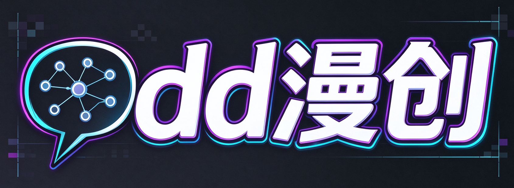

# Odd漫创 AI 短剧创作工作流

<div align="center">
  
  <p><strong>把小说、剧本和故事想法，整理成角色、分镜、AI 图片和视频。</strong></p>
  <p>Odd漫创是独立二创项目，继续使用侠客漫 API 服务；项目品牌与 API 服务方相互独立。</p>
</div>

## 功能

- 小说改编、剧本整理和分集设计
- 自动提取角色、场景、道具和分镜
- 生成人物参考图、场景图和故事板
- 批量生成视频片段并查看任务进度
- 添加原声、音效和 BGM，合成并导出成片
- 图片、视频工作台与节点画布
- 项目导入、导出和本地保存

## 本地开发

需要 Node.js 20.19 或更高版本。

Windows 用户可以双击 `start.bat` 启动；浏览器打开 `http://localhost:8022`。

手动启动：

```powershell
npm ci
npm ci --prefix bff
Copy-Item .env.example .env
npm run dev:bff
```

另开一个终端运行：

```powershell
npm run dev
```

首次启动后，在“API 设置”中填写你有权使用的 API Key。侠客漫 API 的默认服务地址和兼容配置仍保留。API Key 保存在本地浏览器或运行环境中，请勿提交到 GitHub。

## 网页版部署

项目包含 Vercel 静态前端和 API 反向代理配置，详见 [Vercel 部署说明](deploy/vercel/README.md)。当前 BFF 依赖 Node.js、FFmpeg、文件存储和持续运行的后台任务；因此 Vercel 只托管前端/API 入口，仍需另行部署完整 BFF 服务，并设置 `ODDMANCHUANG_BFF_ORIGIN`。不要将无认证的 BFF 公开给朋友使用。

## 桌面版

Windows 桌面版基于 Electron，本地运行网页界面和 BFF。打包方式与要求见 [桌面版说明](deploy/desktop/README.md)。安装包默认不包含 FFmpeg；需要本机视频合成时应连同 FFmpeg/ffprobe 一起打包并验证。

## 更多说明

- [功能说明](docs/FEATURES.md)
- [API 配置说明](docs/API_CONFIGURATION.md)
- [部署说明](docs/DEPLOYMENT.md)
- [项目架构](docs/ARCHITECTURE.md)
- [安全说明](SECURITY.md)

## 许可说明

本项目适用 [PolyForm Noncommercial License 1.0.0](LICENSE)。使用、修改和分发本项目时，请遵循仓库中的许可证条款；许可证未授予的权利须另行取得相应授权。
